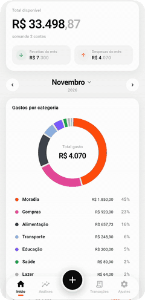
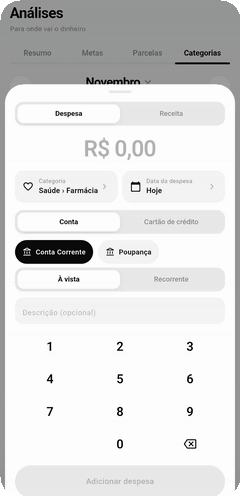
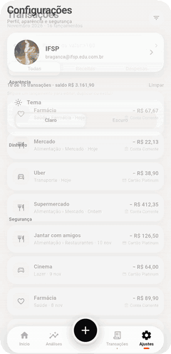
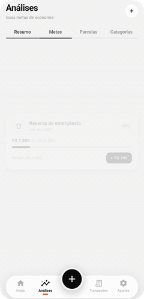
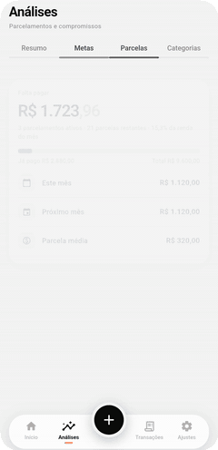
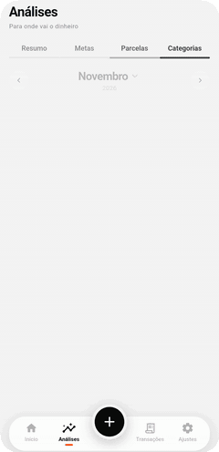
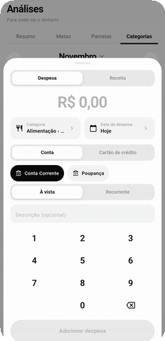
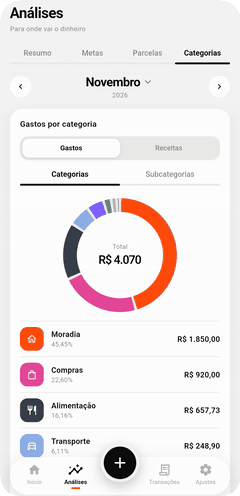

# Finanças

Aplicativo de controle financeiro pessoal feito em **Flutter** para Android e iOS: gastos e receitas,
contas e cartões de crédito, parcelas, metas de economia e análises, com tema claro e escuro.

<p align="center">
  
  &nbsp;
  
  &nbsp;
  
</p>

## Funcionalidades

- **Início** – saldo total disponível, receitas e despesas do mês, gastos por categoria em gráfico de rosca,
  conta e cartão favoritos (com o ciclo de fatura) e últimas transações. Tocar no mês abre um seletor com
  os 12 meses do ano.
- **Adicionar lançamento** – teclado numérico próprio (até R$ 999.999.999,99), categoria **e subcategoria**,
  data em calendário, conta ou cartão de crédito. Aceita **parcelado** (até 120x, por valor total ou por parcela)
  e **recorrente** (mensal, até 120 meses).
- **Transações** – busca por texto e por `valor:>100`, filtro por mês, conta e cartão. Segure um lançamento para
  **editar, duplicar ou excluir** (em parcelas e recorrências você escolhe se vale só para a atual ou para as próximas).
- **Análises**, em quatro abas:
  - **Resumo** – receitas × despesas dos últimos 3 ou 6 meses, taxa de economia e gastos totais por conta e cartão.
  - **Metas** – metas de economia com prazo e progresso. O dinheiro entra e sai pela categoria _Metas_ ao adicionar um lançamento.
  - **Parcelas** – quanto falta pagar, compromisso mensal até a última parcela acabar e lista de parcelamentos ativos e encerrados.
  - **Categorias** – gastos e receitas por categoria/subcategoria e evolução dos últimos 6 meses.
- **Configurações** – perfil (nome, e-mail e foto), tema claro/escuro, minhas contas, meus cartões,
  senha de acesso e sair da conta.

## Telas

### Análises

<table align="center">
  <tr>
    <td align="center"><br><sub><b>Metas</b></sub></td>
    <td align="center"><br><sub><b>Parcelas</b></sub></td>
    <td align="center"><br><sub><b>Categorias</b></sub></td>
  </tr>
</table>

### Lançamentos e transações

<table align="center">
  <tr>
    <td align="center"><br><sub><b>Categoria e subcategoria</b></sub></td>
    <td align="center"><br><sub><b>Adicionar despesa</b></sub></td>
    <td align="center"><br><sub><b>Transações</b></sub></td>
  </tr>
</table>

### Configurações e tema escuro

<p align="center">
  
</p>

## Instalação

### 1. Pré-requisitos

| Ferramenta | Versão | Para quê |
| --- | --- | --- |
| [Git](https://git-scm.com/downloads) | qualquer recente | baixar o projeto |
| [Flutter SDK](https://docs.flutter.dev/get-started/install) | 3.47 ou superior (Dart 3.13.7+) | executar o app |
| [Android Studio](https://developer.android.com/studio) | recente | SDK do Android e emulador |
| Xcode (somente macOS) | recente | rodar no iOS (deployment target 15.0) |

Depois de instalar o Flutter, confira se está tudo certo no ambiente:

```bash
flutter doctor
```

Corrija o que aparecer com um ✗ (por exemplo, aceitar as licenças do Android com `flutter doctor --android-licenses`).

### 2. Baixar o projeto

```bash
git clone https://github.com/Pratesarthur/controlador-de-gastos.git
cd controlador-de-gastos
```

> O código do app está na branch `feature/flutter-app`. Se ela não for a padrão, use `git checkout feature/flutter-app`.

### 3. Instalar as dependências

```bash
flutter pub get
```

### 4. Executar

Abra um emulador Android (Android Studio ▸ Device Manager), o simulador do iOS ou conecte um celular com
a depuração USB ativada. Confira os dispositivos disponíveis e rode:

```bash
flutter devices
flutter run
```

Se houver mais de um dispositivo, escolha com `flutter run -d <id-do-dispositivo>`.

### 5. Gerar o app para instalar no celular (opcional)

```bash
flutter build apk --release
```

O arquivo fica em `build/app/outputs/flutter-apk/app-release.apk`. Copie-o para o aparelho Android e
instale (pode ser necessário permitir instalação de fontes desconhecidas). Para iOS é preciso um Mac com Xcode
e uma conta de desenvolvedor Apple: `flutter build ios`.

### Testes e análise estática

```bash
flutter test
flutter analyze
```

## Estrutura

| Arquivo                                                                                  | O que faz                                                                 |
| ---------------------------------------------------------------------------------------- | ------------------------------------------------------------------------- |
| `lib/main.dart`                                                                          | Tema, navegação inferior e tela de entrada                                |
| `lib/store.dart`                                                                         | Estado em memória: lançamentos, contas, cartões, metas, perfil e análises |
| `lib/categories.dart`                                                                    | Categorias e subcategorias                                                |
| `lib/overview_screen.dart`                                                               | Início                                                                    |
| `lib/add_sheet.dart`                                                                     | Adicionar/editar lançamento                                               |
| `lib/reports_screen.dart`                                                                | Transações e filtros                                                      |
| `lib/analytics_screen.dart`, `analytics_extra.dart`, `goals_tab.dart`, `goal_sheet.dart` | Análises, Parcelas, Categorias e Metas                                    |
| `lib/settings_screen.dart`, `accounts_screen.dart`                                       | Configurações, perfil, senha, contas e cartões                            |
| `lib/theme.dart`, `lib/widgets.dart`                                                     | Cores (claro/escuro), tipografia e componentes                            |

## Observações

- Os dados ficam **somente em memória**: ao fechar o app eles voltam ao exemplo inicial. O armazenamento local
  (SQLite, Firebase etc.) ainda não foi implementado, e `Store` foi pensado para ser trocado por um repositório real.
- A senha e o "sair da conta" são um bloqueio **local**; ainda não há login com servidor.

## Finalidade do Projeto

Este projeto foi desenvolvido para nos familiarizarmos com uma nova IDE, linguagem, plataforma e abordagem de design. Além de construir o aplicativo, também praticamos o controle de versão com Git e GitHub, para entender desde o início como funciona um fluxo de trabalho profissional.
